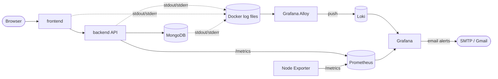

# Green-Pitch

A MERN-stack e-commerce application (React frontend, Express API, MongoDB) packaged with Docker Compose and wired to a full observability stack: **metrics** with Prometheus, **logs** with Grafana Alloy and Loki, **dashboards and email alerts** with Grafana.

Live demo of the app: <https://green-pitch.netlify.app/>

It may take some time since render takes a bit of time to start

---

## Table of contents

1. [Architecture](#architecture)
2. [Log collection with Grafana Alloy and Loki](#log-collection-with-grafana-alloy-and-loki)
3. [Metrics collection](#metrics-collection)
4. [Dashboards and alerting](#dashboards-and-alerting)
5. [Quick start](#quick-start)
6. [Configuration](#configuration)
7. [Services and ports](#services-and-ports)
8. [Data persistence](#data-persistence)
9. [Project structure](#project-structure)
10. [Security notes](#security-notes)
11. [Troubleshooting](#troubleshooting)

---

## Architecture



Two independent pipelines feed Grafana:

| Signal  | Collector                   | Store      | How data arrives                          |
|---------|-----------------------------|------------|-------------------------------------------|
| Logs    | **Grafana Alloy**           | **Loki**   | Alloy reads container output and *pushes* |
| Metrics | Prometheus (scraper)        | Prometheus | Prometheus *pulls* `/metrics` every 15 s  |

---

## Log collection with Grafana Alloy and Loki

### Why a collector is needed

Loki stores and searches logs, but it does not go and fetch them. Each container writes its logs to stdout/stderr, and Docker keeps that text on disk. **Grafana Alloy** is the agent that picks those lines up, labels them, and delivers them to Loki. Without it, Loki stays empty.

```
container stdout/stderr  ->  Alloy (discover, read, label)  ->  Loki (store, index)  ->  Grafana (search, alert)
```

### What Alloy does here

Alloy runs as the `alloy` service and is configured in [`alloy/config.alloy`](alloy/config.alloy). It performs four steps:

1. **Discover** - `discovery.docker` asks the Docker daemon (through `/var/run/docker.sock`) which containers are running, and re-checks every 5 seconds. New containers are picked up automatically.
2. **Label** - `discovery.relabel` attaches two labels to every log line:
   - `container` - the container name (for example `green-pitch-backend`)
   - `service` - the Compose service name (for example `backend`, `mongodb`, `loki`)
3. **Read** - `loki.source.docker` follows each container's log stream, like `docker logs -f` for all containers at once.
4. **Ship** - `loki.write` pushes the labelled lines to `http://loki:3100/loki/api/v1/push`.

Because collection happens at the Docker level, **no application code changes are needed**: anything a container prints becomes searchable.

### Loki

Loki runs as a single node with local filesystem storage, configured in [`loki/config.yml`](loki/config.yml):

| Setting            | Value        | Meaning                                              |
|--------------------|--------------|------------------------------------------------------|
| Storage            | filesystem   | chunks and index live in the `loki_data` volume      |
| Schema             | TSDB, v13    | current recommended index layout                     |
| Retention          | 168 h (7 days) | the compactor deletes older logs automatically     |
| Multi-tenancy      | disabled     | `auth_enabled: false`, single default tenant         |

### Grafana data source

Loki is registered automatically through provisioning in
[`grafana/provisioning/datasources/`](grafana/provisioning/datasources). The URL is `http://loki:3100` (the Compose service name, not `localhost`).

### Querying logs (LogQL)

Open Grafana, go to **Explore**, select **Loki**, and try:

```logql
# all backend logs
{service="backend"}

# every container at once
{service=~".+"}

# only lines containing an error (case-insensitive)
{service="backend"} |~ "(?i)(error|exception|failed|fatal)"

# a single container
{container="green-pitch-mongodb"}

# log volume per service, per minute
sum by (service) (count_over_time({service=~".+"}[1m]))

# error lines per minute (useful for panels and alerts)
sum(count_over_time({service="backend"} |~ "(?i)(error|exception|failed|fatal)" [1m]))
```

> A query needs at least one label matcher. `{}` is rejected by Loki; use `{service=~".+"}` to match everything.

### Good logging practice for the backend

- Write to **stdout/stderr** (`console.log`, `console.error`). Alloy only collects container output, not log files inside the container.
- Log one line per request (for example with `morgan`) so request traffic appears in Loki.
- Prefer structured JSON lines; Loki can then filter on fields with `| json | status >= 500`.
- Never log passwords, tokens, cookies or full request bodies.

### Limits of this setup

- Logs are collected from **Docker containers** only. Kubernetes pod logs need Alloy running inside the cluster (`discovery.kubernetes`).
- Alloy reads the Docker socket, which gives it broad access to Docker. This is acceptable for local development; do not expose it on a shared host.
- Lines printed before Alloy first sees a container may not be ingested.

---

## Metrics collection

| Target          | Endpoint                   | What it provides                                       |
|-----------------|----------------------------|--------------------------------------------------------|
| `backend`       | `backend:5000/metrics`     | request count, latency histogram, Node.js process stats |
| `node-exporter` | `node-exporter:9100`       | CPU, memory, disk and network of the Docker host VM    |
| `prometheus`    | `localhost:9090`           | Prometheus self-metrics                                |

Scrape jobs are defined in [`prometheus/prometheus.yml`](prometheus/prometheus.yml). Check that every target is **UP** at <http://localhost:9090/targets>.

Useful queries:

```promql
sum(rate(http_requests_total{route!="/metrics"}[1m]))                                   # requests/second
100 * sum(rate(http_requests_total{status_code=~"5.."}[1m])) / sum(rate(http_requests_total[1m]))   # 5xx error %
histogram_quantile(0.95, sum by (le) (rate(http_request_duration_seconds_bucket[1m])))  # p95 latency
100 - (avg(rate(node_cpu_seconds_total{mode="idle"}[1m])) * 100)                        # CPU %
(1 - node_memory_MemAvailable_bytes / node_memory_MemTotal_bytes) * 100                 # RAM %
```

---

## Dashboards and alerting

Grafana is available at <http://localhost:3000> (login with the credentials from your `.env`).

- **Data sources:** Prometheus and Loki, provisioned automatically.
- **Dashboards:** request rate, error rate, p95 latency, CPU, RAM, disk, network, plus a logs dashboard (log volume per service, error counts, live log panels).
- **Email alerts:** Grafana sends mail through SMTP (Gmail by default). Create contact points and rules under **Alerting**. Typical rules:
  - *High CPU* - Prometheus query on the busiest core above a threshold
  - *Errors in backend logs* - Loki query counting error lines above 0, with "no data" state set to **Normal**

---

## Quick start

**Requirements:** Docker with Docker Compose v2 (included in Docker Desktop).

```bash
# 1. clone
git clone https://github.com/tfprome/Green-Pitch.git
cd Green-Pitch

# 2. create environment files from the examples
cp .env.example .env
cp server/.env.example server/.env      # if present; otherwise create server/.env (see below)

# 3. edit both files and fill in real values

# 4. start everything
docker compose up -d --build

# 5. check status
docker compose ps
```

Open:

| What            | URL                          |
|-----------------|------------------------------|
| Frontend        | <http://localhost:5173>      |
| Backend API     | <http://localhost:5000>      |
| Grafana         | <http://localhost:3000>      |
| Prometheus      | <http://localhost:9090>      |
| Alloy UI        | <http://localhost:12345>     |
| Loki readiness  | <http://localhost:3100/ready> |

Stop, keeping all data:

```bash
docker compose down
```

> `docker compose down -v` also deletes the named volumes (database, dashboards, metrics, logs). Use it only for a full reset.

---

## Configuration

Create the files below and keep them out of Git (they are in `.gitignore`).

**`.env`** (read by Docker Compose)

```dotenv
GRAFANA_ADMIN_USER=admin
GRAFANA_ADMIN_PASSWORD=change-me
SMTP_USER=you@gmail.com
SMTP_PASSWORD=your-gmail-app-password
```

For Gmail you need 2-Step Verification and an **App password**; a normal account password will not work.

**`server/.env`** (read by the backend container)

```dotenv
PORT=5000
MONGO_URI=mongodb://mongodb:27017/test
# plus any other secrets your API needs (JWT secret, Cloudinary keys, ...)
```

Inside Compose the database host is the service name `mongodb`, not `localhost`.

---

## Services and ports

| Service         | Image                       | Host port | Purpose                         |
|-----------------|-----------------------------|-----------|---------------------------------|
| `frontend`      | built from `./client`       | 5173      | React app                       |
| `backend`       | built from `./server`       | 5000      | Express API and `/metrics`      |
| `mongodb`       | `mongo:8`                   | 27017     | database                        |
| `prometheus`    | `prom/prometheus:v3.15.0`   | 9090      | metrics store                   |
| `node-exporter` | `prom/node-exporter:v1.9.1` | (internal)| host metrics                    |
| `loki`          | `grafana/loki:3.7.0`        | 3100      | log store                       |
| `alloy`         | `grafana/alloy:v1.21.0`     | 12345     | **log collector**               |
| `grafana`       | `grafana/grafana:13.2.4`    | 3000      | dashboards and alerts           |

Containers reach each other by service name on the `green-pitch-network` bridge network (for example `http://prometheus:9090`, `http://loki:3100`).

---

## Data persistence

| Data                              | Location                         |
|-----------------------------------|----------------------------------|
| Database                          | volume `green-pitch-mongo-data`  |
| Prometheus time series (15 days)  | volume `prometheus_data`         |
| Logs (7 days)                     | volume `loki_data`               |
| Grafana dashboards, users, alerts | volume `grafana_data`            |
| Uploaded images                   | bind mount `./server/uploads`    |

Containers can be removed and recreated freely; the data stays in the volumes.

---

## Project structure

```
Green-Pitch/
├── alloy/                       # Alloy config: Docker log discovery and shipping
│   └── config.alloy
├── client/                      # React frontend
├── grafana/
│   └── provisioning/
│       └── datasources/         # Prometheus and Loki data sources
├── loki/
│   └── config.yml               # Loki storage and retention
├── prometheus/
│   └── prometheus.yml           # scrape jobs
├── server/                      # Express API
├── .env.example
├── docker-compose.yaml
└── render.yaml
```

---

## Security notes

This setup is intended for **local development**. Before exposing it anywhere:

- Bind internal services to localhost, for example `"127.0.0.1:9090:9090"`, for Prometheus, Loki, Alloy and MongoDB.
- Enable authentication on MongoDB.
- Do not commit `.env` files, database dumps, or exported data.
- Treat the Docker socket mounted into Alloy as privileged access.

---

## Troubleshooting

| Symptom | Likely cause and fix |
|---|---|
| `no configuration file provided: not found` | Run `docker compose` from the project folder that contains `docker-compose.yaml`. |
| `... config.yml: is a directory` | The file did not exist when Compose started, so Docker created a folder. Delete the folder, create the real file, restart the service. |
| Loki query error: `queries require at least one regexp or equality matcher` | Use a label matcher such as `{service=~".+"}`, not `{}`. |
| A service is missing from the `service` label list | It has printed nothing since Alloy started. Restart it or generate traffic, and check the time range. |
| Grafana data source error `unsupported protocol scheme` | Use `http://prometheus:9090` / `http://loki:3100`, with `http://` and the service name. |
| Prometheus target is DOWN | Check the error on the targets page; confirm the service is on `green-pitch-network` and `/metrics` responds. |
| Alert email never arrives | Send a **Test** from the contact point first; check `docker compose logs grafana` for SMTP errors and verify the Gmail app password. |
| Images return 404 | `./server/uploads` must exist on the host and contain the files; it is bind-mounted to `/app/uploads`. |

---

## License

Add a license of your choice.
